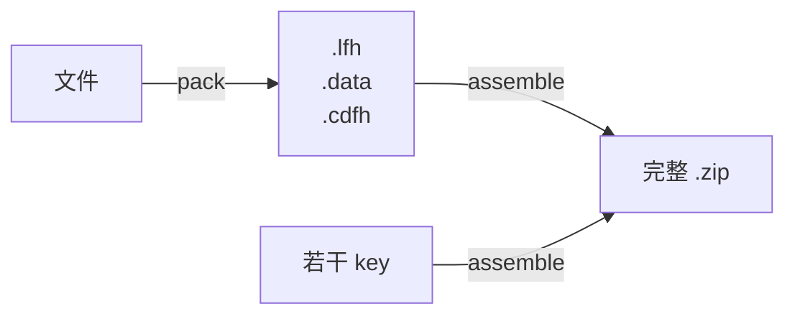

# free-zip

预压缩 ZIP 按需拼装工具：把“压缩”与“打包”拆成两个独立过程，让同一份压缩数据可以被反复、快速地组装成完整的 ZIP。

拼装过程只做字节复制，不再重新压缩，因此又快又省 CPU。

## 两个过程



- `pack`：压缩单个文件一次，落盘为三件套。
- `edit`：原地修改已打包条目的元数据（注释、名字、时间、Unix 模式），不重新压缩、不动 `.data`。
- `assemble`：按顺序逐字节复制每个条目的本地头与数据，最后重建中央目录，追加结尾记录。整个过程顺序写出，条目本地头偏移在写中央目录时才知道——这正是“预存头部”方案成立的关键。

### 三件套命名

每个条目由 *key* 标识，对应三个文件：

| 文件 | 含义 | 规范章节 |
| --- | --- | --- |
| `<key>.lfh` | Local File Header | APPNOTE.TXT §4.3.7 |
| `<key>.data` | 文件数据（已压缩载荷） | APPNOTE.TXT §4.3.8 |
| `<key>.cdfh` | Central Directory File Header 模板，写盘时本地头偏移留 0，assemble 时回填 | APPNOTE.TXT §4.3.12 |

## 模块

| 模块 | 语言 | 入口类 | 产物 |
| --- | --- | --- | --- |
| `:java` | Java 21 | `com.geno1024.ai.freezip.cli.Main` | `java/build/libs/free-zip-java-all.jar` |
| `:kotlin` | Kotlin 2.4 / JVM 21 | `com.geno1024.ai.freezip.cli.MainKt` | `kotlin/build/libs/free-zip-kotlin-all.jar` |

两个模块 API 与产物格式完全一致、可互相混用：Java `pack` 出来的条目可以被 Kotlin `assemble`，反之亦然。

## 构建与运行

```bash
./gradlew build                 # 编译 + 测试两个模块
./gradlew :java:fatJar :kotlin:fatJar   # 生成自包含可执行 jar
./gradlew :java:test :kotlin:test       # 仅测试
```

运行（以 Java 版为例，Kotlin 版把 jar 名换成 `free-zip-kotlin-all.jar`）：

```bash
java -jar java/build/libs/free-zip-java-all.jar \
  pack hello.txt store/hello.txt --method deflate
java -jar java/build/libs/free-zip-java-all.jar \
  edit store/hello.txt --comment "greeting"
java -jar java/build/libs/free-zip-java-all.jar \
  assemble out.zip store --zip64 auto
java -jar java/build/libs/free-zip-java-all.jar size store
```

### CLI

```
free-zip pack     <input-file> <output-prefix> [--name N] [--method store|deflate] [--level L]
free-zip edit     <entry>                     [--name N] [--comment C] [--time ISO8601] [--mode OCTAL]
free-zip assemble <output.zip> <entry|dir>...  [--zip64 auto|always|never] [--comment C]
free-zip size     <entry|dir>...               [--zip64 auto|always|never] [--comment C]
```

- `assemble` / `size` 接受条目 key，或包含 `*.lfh` 的目录（目录内按文件名排序）。
- `size` 精确计算 `assemble` 将产生的字节数，可用于 HTTP `Content-Length`，且不读取任何载荷。
- `--zip64`：`auto`（仅在字段溢出时写 Zip64 记录）、`always`（总是写，并使经典 EOCD 字段饱和）、`never`。
- `--comment`（`assemble` / `size`）：写入**归档注释**（End of Central Directory record，§4.3.16），以 UTF-8 编码，规范上限 65535 字节。**条目注释**另走 `edit --comment`（见下），不放在 `pack` 里，因为注释与压缩无关、属于纯元数据改动。

### 编辑条目（`edit`）

`edit` 原地修改一个已打包条目的元数据：读取 `<key>.lfh` 与 `<key>.cdfh`，套用若干**操作**，再把两个头写回。它**从不触碰 `<key>.data`**，因此不需要重新压缩，sizes 与 CRC 保持不变。

| 操作 | CLI | 影响范围 | 规范章节 |
| --- | --- | --- | --- |
| `SetComment` | `--comment C` | 仅中央目录 | §4.3.12 |
| `Rename` | `--name N` | 本地头 + 中央目录 | §4.3.7 / §4.3.12 |
| `SetModificationTime` | `--time ISO8601` | 本地头 + 中央目录 | §4.4.6 |
| `SetUnixMode` | `--mode OCTAL` | 仅中央目录（external attributes，同时置 host 为 UNIX） | §4.4.15 |

操作在代码里是 `StoredEntry -> StoredEntry` 的纯函数（`EntryOperation`），`EntryEditor` 负责加载、按顺序折叠操作、写回；`.cdfh` 始终以本地头偏移 0 的模板形式保存，真实偏移在 assemble 时回填。

```bash
java -jar .../free-zip-java-all.jar edit store/hello.txt \
  --name greeting.txt --comment "hi" --time 2001-02-03T04:05:06 --mode 755
```

## Zip64 说明

APPNOTE.TXT §4.5.3 的 Zip64 扩展信息字段（header id `0x0001`）按 16/32 位字段各自溢出独立判定：

- 本地头中原始大小与压缩大小**必须成对**出现在 Zip64 extra 中（§4.5.3 规定）。
- 中央目录中，原始大小、压缩大小、本地头偏移、磁盘号各自按需出现。
- 当任一字段溢出时，条目的“version needed to extract”提升到 4.5（`VERSION_NEEDED_ZIP64`）。

结尾记录的字段定义见 §4.3.14（Zip64 EOCD record）、§4.3.15（Zip64 EOCD locator）、§4.3.16（经典 EOCD）。

## 代码约定

- 代码文件名与类名尽量贴近 APPNOTE.TXT 术语（如 `LocalFileHeader`、`CentralDirectoryFileHeader`、`GeneralPurposeBitFlag`、`MsDosDateTime`、`Zip64ExtendedInformationExtraField`）。
- 与 ZIP 结构相关的代码带简短注释指向规范章节（如 `§4.3.7`）。
- 所有整数字段按 §4.4.1.1 以小端序编码，统一由 `LittleEndian` 处理。
- 不设置通用位标志第 3 位（data descriptor），因此无需尾随描述符。

## 目录

```
build.gradle.kts        根脚本（含 build_count.txt 构建计数）
build_count.txt         每次 Gradle 配置阶段 +1，随提交一起提交
java/                   Java 实现与测试
kotlin/                 Kotlin 实现与测试
```
